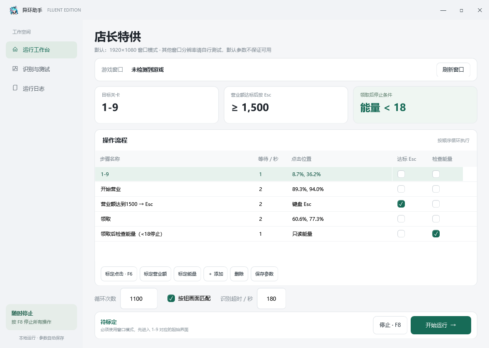

<h1> 异环店长特供助手</h1>

[](#使用)
[](LICENSE)
[](src)
[](src/ModernWindow.xaml)
[](src)

店长特供 1-9 自动点击工具。配队负责营业，程序负责选关、开始、退出、领取和检查能量。



## 使用

从 [Releases](https://github.com/FireFlyAR26710-y/NTE-Store-Assistant/releases/latest) 下载，解压后运行 `NTEStoreAssistant.exe`。

**必须使用窗口模式。默认参数按 1920×1080 游戏客户区标定。其他窗口分辨率请自行测试，默认参数不保证可用。**

配队使用 **早雾、薄荷、海月**，三人的**都市特技都需要升到 3 级**。把游戏停在选关界面后再启动。首次打开已带默认坐标和识别区域；位置不对就在测试页检查、重新标定。

- 黄色营业额达到 1500 后按 Esc，再点击领取。
- 领取后检查能量，小于 18 停止，18 及以上继续。
- 默认循环 1100 次，识别超时 180 秒；能量无法确认时最多等待 45 秒。
- F7 开始，F8 停止。F6 记录点击位置，F9/F10 记录识别区域的两个角。

参数保存在程序旁的 `settings.json`，已有配置优先，不会被默认值覆盖。测试页可以查看截图、OCR 原文，也可以单独测试一次鼠标点击。

## 编译

Windows x64，.NET Framework 4.8、Windows SDK。安装对应开发组件后运行：

```powershell
.\build.ps1
```

产物在 `dist`。界面是 WPF，OCR 用 Windows 自带组件，不需要 Python。

非官方工具。自动化操作可能违反游戏规则，使用前自行确认。OCR 仍可能误读，第一次建议只跑一轮。
